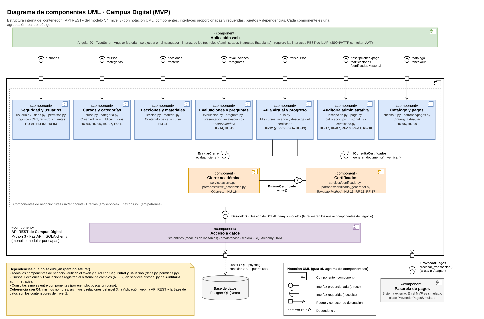
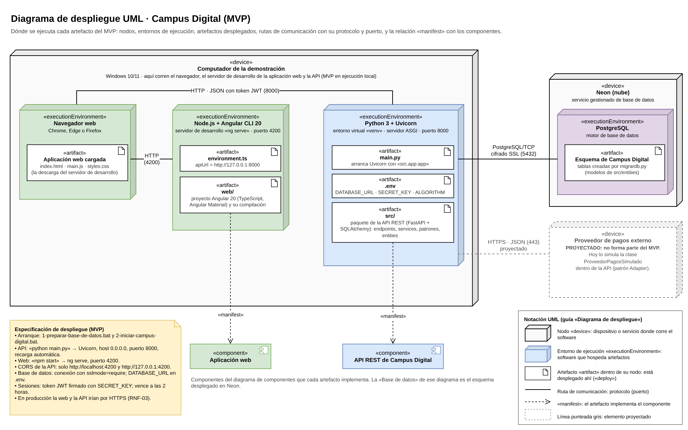

# Arquitectura: componentes y despliegue (UML)

Estos dos diagramas son la vista UML de la misma arquitectura que el documento describe con el modelo C4: los contenedores del nivel 2 (aplicación web, API REST, base de datos) y los componentes del nivel 3 de la API.

## Diagrama de componentes

- Archivo editable: [`diagramas/Diagrama-de-componentes-UML.drawio`](diagramas/Diagrama-de-componentes-UML.drawio)
- Enlace editable en draw.io: https://app.diagrams.net/#G1KNcIHJjRbOaGETqvl0mdG54eTRRUb5BR

| Componente | Código | Historias y requisitos |
|---|---|---|
| Aplicación web | `Frontend-plataforma-de-cursos-online/web/src/app` | Las 16 historias |
| Seguridad y usuarios | `endpoints/usuario.py`, `endpoints/deps.py`, `services/permisos.py` | HU-01, HU-02, HU-03 |
| Cursos y categorías | `endpoints/curso.py`, `endpoints/categoria.py` | HU-04, HU-05, HU-07, HU-10 |
| Lecciones y materiales | `endpoints/leccion.py`, `endpoints/material.py` | HU-11 |
| Evaluaciones y preguntas | `endpoints/evaluacion.py`, `endpoints/pregunta.py`, `services/presentacion_evaluacion.py`, `patrones/factory_preguntas.py` | HU-14, HU-15 |
| Aula virtual y progreso | `endpoints/aula.py` | HU-12 y la descarga de la HU-13 |
| Auditoría administrativa | `endpoints/inscripcion.py`, `pago.py`, `calificacion.py`, `historial.py`, `certificado.py` | HU-17, RF-07, RF-10, RF-11, RF-16 |
| Catálogo y pagos | `endpoints/checkout.py`, `patrones/pagos.py` | HU-06, HU-09 |
| Cierre académico | `services/cierre.py`, `patrones/cierre_academico.py` | HU-16 |
| Certificados | `services/certificado.py`, `patrones/certificado_generador.py` | HU-13, RF-17 |
| Acceso a datos | `src/entities`, `src/database` | Todos |
| Pasarela de pagos (externa) | En el MVP la simula `ProveedorPagosSimulado` (`patrones/pagos.py`) | HU-09 |

## Diagrama de despliegue

- Archivo editable: [`diagramas/Diagrama-de-despliegue-UML.drawio`](diagramas/Diagrama-de-despliegue-UML.drawio)
- Enlace editable en draw.io: https://app.diagrams.net/#G17oBa5hH6FW3AqrR1OxVHoieDDi1FVqVL

| Nodo | Entorno de ejecución | Artefacto | Para qué |
|---|---|---|---|
| Computador de la demostración | Navegador web | Aplicación web compilada (`index.html`, `main.js`, `styles.css`) | Ejecuta la interfaz |
| Computador de la demostración | Node.js + Angular CLI 20 (`ng serve`, puerto 4200) | `web/` (proyecto Angular) y `environment.ts` | Compila y entrega la aplicación web al navegador |
| Computador de la demostración | Python 3 + Uvicorn (puerto 8000) | `src/` (paquete de la API), `main.py`, `.env` | Ejecuta la API REST |
| Neon (PostgreSQL gestionado) | PostgreSQL | Esquema de Campus Digital (tablas creadas por `migrardb.py`) | Guarda los datos del sistema |
| Proveedor de pagos (proyectado) | — | — | No forma parte del MVP: se simula dentro de la API |

Comunicación: navegador → `ng serve` por HTTP (4200); navegador → API por HTTP (8000, JSON y token JWT, CORS limitado a la aplicación web); API → Neon por TCP 5432 con SSL. La demostración es local, por eso usa HTTP; en producción iría por HTTPS.
