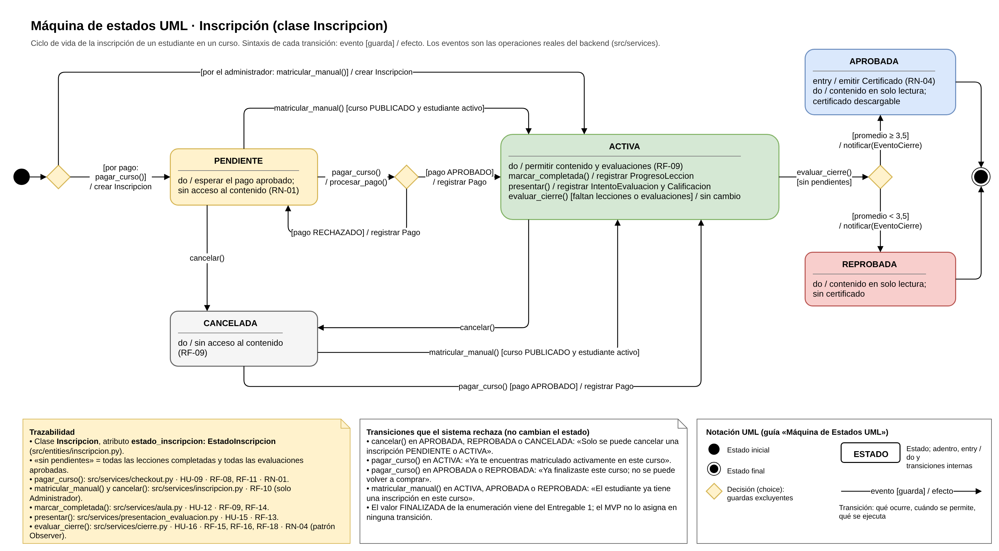

# Máquina de estados de la inscripción

Entidad modelada: `Inscripcion` (`Backend-plataforma-de-cursos-online/src/entities/inscripcion.py`). Sus estados son los valores de la enumeración `EstadoInscripcion`; no son épicas ni pantallas.

- Archivo editable: [`diagramas/Maquina-de-estados-Inscripcion.drawio`](diagramas/Maquina-de-estados-Inscripcion.drawio)
- Enlace editable en draw.io: https://app.diagrams.net/#G1d02dMF1Y56e4t_KxHCB-Ia7Z5bbZ4jVa

## Estados

| Estado | Qué significa | Qué puede hacer el estudiante | Tipo |
|---|---|---|---|
| PENDIENTE | Se intentó pagar el curso y el pago todavía no se ha aprobado. | Volver a pagar. No ve el contenido (RN-01). | Intermedio |
| ACTIVA | El pago fue aprobado o el administrador lo matriculó. | Ver lecciones y materiales, marcar avance y presentar evaluaciones. | Intermedio |
| CANCELADA | El administrador canceló la inscripción. | Nada dentro del curso. Puede volver a ACTIVA si paga de nuevo o si el administrador lo matricula. | Intermedio |
| APROBADA | Terminó el curso con promedio ponderado de 3,5 o más. | Ver el contenido en solo lectura y descargar el certificado. | Final |
| REPROBADA | Terminó el curso con promedio ponderado menor que 3,5. | Ver el contenido en solo lectura. No tiene certificado. | Final |

`FINALIZADA` existe en la enumeración por compatibilidad con datos antiguos; ninguna operación del MVP la asigna.

## Matriz de análisis

Los eventos son operaciones reales del backend: `pagar_curso()` (`services/checkout.py`), `matricular_manual()` y `cancelar()` (`services/inscripcion.py`), `marcar_completada()` (`services/aula.py`), `presentar()` (`services/presentacion_evaluacion.py`) y `evaluar_cierre()` (`services/cierre.py`).

| N.º | Estado actual | Evento | Condición de guarda | Acción (efecto) | Nuevo estado | Regla o requisito |
|---|---|---|---|---|---|---|
| 1 | (inicial) | `pagar_curso()` | [el curso está PUBLICADO y el estudiante no tiene inscripción en él] | Crear la `Inscripcion` y procesar el pago (sigue en la fila 3 o 4) | PENDIENTE | RF-08 · RN-01 · HU-09 |
| 2 | (inicial) | `matricular_manual()` | [el curso está PUBLICADO y el usuario es un Estudiante activo] | Crear la `Inscripcion` | ACTIVA | RF-10 |
| 3 | PENDIENTE | `pagar_curso()` | [la pasarela responde pago APROBADO] | Registrar el `Pago` aprobado | ACTIVA | RN-01 · HU-09 esc. 1 |
| 4 | PENDIENTE | `pagar_curso()` | [la pasarela responde pago RECHAZADO] | Registrar el `Pago` rechazado | PENDIENTE | RN-01 · HU-09 esc. 2 |
| 5 | PENDIENTE | `matricular_manual()` | [el curso está PUBLICADO y el usuario es un Estudiante activo] | — | ACTIVA | RF-10 |
| 6 | PENDIENTE | `cancelar()` | — | — | CANCELADA | RF-10 |
| 7 | ACTIVA | `marcar_completada()` | [la lección no estaba marcada] | Registrar `ProgresoLeccion` y llamar a `evaluar_cierre()` | ACTIVA (transición interna) | RF-09 · RF-14 · HU-12 |
| 8 | ACTIVA | `presentar()` | [la evaluación no estaba aprobada] | Registrar `IntentoEvaluacion` y `Calificacion` y llamar a `evaluar_cierre()` | ACTIVA (transición interna) | RF-13 · HU-15 |
| 9 | ACTIVA | `evaluar_cierre()` | [falta aprobar evaluaciones o completar lecciones] | — | ACTIVA | HU-16 esc. 3 |
| 10 | ACTIVA | `evaluar_cierre()` | [todo aprobado y completado, y promedio ponderado ≥ 3,5] | `notificar(EventoCierre)`: se guarda el `RegistroCierre` y se emite el `Certificado` | APROBADA | RN-04 · RF-15, RF-16, RF-18 · HU-16 esc. 1 |
| 11 | ACTIVA | `evaluar_cierre()` | [todo aprobado y completado, y promedio ponderado < 3,5] | `notificar(EventoCierre)`: se guarda el `RegistroCierre`; no hay certificado | REPROBADA | RN-04 · RF-15, RF-18 · HU-16 esc. 2 |
| 12 | ACTIVA | `cancelar()` | — | — | CANCELADA | RF-10 |
| 13 | CANCELADA | `matricular_manual()` | [el curso está PUBLICADO y el usuario es un Estudiante activo] | — | ACTIVA | RF-10 |
| 14 | CANCELADA | `pagar_curso()` | [la pasarela responde pago APROBADO] | Registrar el `Pago` aprobado | ACTIVA | RN-01 · HU-09 |

## Transiciones que el sistema rechaza

| Estado actual | Evento | Respuesta del sistema | Regla o requisito |
|---|---|---|---|
| APROBADA, REPROBADA o CANCELADA | `cancelar()` | 400 · «Solo se puede cancelar una inscripción PENDIENTE o ACTIVA» | RF-10 |
| ACTIVA | `pagar_curso()` | 400 · «Ya te encuentras matriculado activamente en este curso». No se cobra otra vez. | HU-09 esc. 3 |
| APROBADA o REPROBADA | `pagar_curso()` | 400 · «Ya finalizaste este curso; no se puede volver a comprar» | HU-09 (criterio ajustado en el E2) |
| ACTIVA, APROBADA o REPROBADA | `matricular_manual()` | 400 · «El estudiante ya tiene una inscripción en este curso» | RF-10 |
| PENDIENTE o CANCELADA | ver el contenido o `marcar_completada()` | 403 · «No cuenta con una inscripción activa para visualizar este contenido» | RN-01 · HU-12 esc. 4 |
| APROBADA o REPROBADA | `marcar_completada()` | 403 · «No cuenta con una inscripción activa para visualizar este contenido». Después del cierre el avance ya no cambia. | HU-16 |
| APROBADA o REPROBADA | `presentar()` | 400 · «Esta evaluación ya fue aprobada; el resultado queda en modo de solo lectura» | HU-15 esc. 3 |
| CANCELADA | `pagar_curso()` con pago RECHAZADO | 200 con `aprobado = false`: se registra el pago rechazado y la inscripción sigue CANCELADA | RN-01 |

## Casos de prueba derivados

Archivo: `Backend-plataforma-de-cursos-online/tests/test_maquina_estados_inscripcion.py`.

| Caso | Estado inicial y evento | Condición | Resultado esperado | Prueba automática |
|---|---|---|---|---|
| CP-01 | (inicial) · `pagar_curso()` | Pago RECHAZADO | PENDIENTE y un pago rechazado guardado | `test_cp01_primer_pago_rechazado_crea_la_inscripcion_pendiente` |
| CP-02 | (inicial) · `pagar_curso()` | Pago APROBADO | ACTIVA y un pago aprobado guardado | `test_cp02_primer_pago_aprobado_crea_la_inscripcion_activa` |
| CP-03 | (inicial) · `matricular_manual()` | Curso publicado y estudiante activo | ACTIVA | `test_cp03_matricula_manual_crea_la_inscripcion_activa` |
| CP-04 | PENDIENTE · `pagar_curso()` | Pago APROBADO después de un rechazo | ACTIVA; sigue habiendo una sola inscripción | `test_cp04_reintento_de_pago_aprobado_activa_la_misma_inscripcion` |
| CP-05 | PENDIENTE · `pagar_curso()` | Pago RECHAZADO otra vez | PENDIENTE; dos pagos rechazados | `test_cp05_segundo_pago_rechazado_sigue_pendiente` |
| CP-06 | PENDIENTE · `matricular_manual()` | Curso publicado y estudiante activo | ACTIVA; la misma inscripción | `test_cp06_matricula_manual_reactiva_una_inscripcion_pendiente` |
| CP-07 | PENDIENTE · `cancelar()` | — | CANCELADA | `test_cp07_cancelar_una_inscripcion_pendiente` |
| CP-08 | ACTIVA · `cancelar()` | — | CANCELADA; el estudiante ya no ve el contenido | `test_cp08_cancelar_una_inscripcion_activa_quita_el_acceso` |
| CP-09 | CANCELADA · `matricular_manual()` | Curso publicado y estudiante activo | ACTIVA | `test_cp09_matricula_manual_reactiva_una_inscripcion_cancelada` |
| CP-10 | CANCELADA · `pagar_curso()` | Pago APROBADO | ACTIVA | `test_cp10_pago_aprobado_reactiva_una_inscripcion_cancelada` |
| CP-11 | CANCELADA · `pagar_curso()` | Pago RECHAZADO | Sigue CANCELADA | `test_cp11_pago_rechazado_no_cambia_una_inscripcion_cancelada` |
| CP-12 | ACTIVA · `evaluar_cierre()` | Todo completo y promedio ≥ 3,5 | APROBADA, con registro de cierre y certificado | `test_cp12_cierre_automatico_aprueba_y_emite_certificado` |
| CP-13 | ACTIVA · `evaluar_cierre()` | Todo completo y promedio < 3,5 | REPROBADA, con registro de cierre y sin certificado | `test_cp13_cierre_automatico_reprueba_sin_certificado` |
| CP-14 | ACTIVA · `evaluar_cierre()` | Faltan evaluaciones o lecciones | Sigue ACTIVA | `test_cp14_con_pendientes_el_cierre_no_cambia_el_estado` |
| CP-15 | APROBADA · `cancelar()` | Transición no permitida | 400 y sigue APROBADA | `test_cp15_no_se_cancela_una_inscripcion_aprobada` |
| CP-16 | REPROBADA · `cancelar()` | Transición no permitida | 400 y sigue REPROBADA | `test_cp16_no_se_cancela_una_inscripcion_reprobada` |
| CP-17 | CANCELADA · `cancelar()` | Transición no permitida | 400 y sigue CANCELADA | `test_cp17_no_se_cancela_dos_veces` |
| CP-18 | ACTIVA · `pagar_curso()` | Transición no permitida | 400 «Ya te encuentras matriculado…»; no se crea ningún pago | `test_cp18_pagar_con_inscripcion_activa_se_rechaza_sin_cobrar` |
| CP-19 | APROBADA · `pagar_curso()` | Transición no permitida | 400 «Ya finalizaste este curso…» | `test_cp19_pagar_con_inscripcion_aprobada_se_rechaza` |
| CP-20 | REPROBADA · `pagar_curso()` | Transición no permitida | 400 «Ya finalizaste este curso…» | `test_cp20_pagar_con_inscripcion_reprobada_se_rechaza` |
| CP-21 | ACTIVA · `matricular_manual()` | Transición no permitida | 400 «El estudiante ya tiene una inscripción en este curso» | `test_cp21_matricular_a_quien_ya_esta_activo_se_rechaza` |
| CP-22 | APROBADA · `matricular_manual()` | Transición no permitida | 400 con el mismo mensaje | `test_cp22_matricular_a_quien_ya_aprobo_se_rechaza` |
| CP-23 | REPROBADA · `matricular_manual()` | Transición no permitida | 400 con el mismo mensaje | `test_cp23_matricular_a_quien_ya_reprobo_se_rechaza` |
| CP-24 | APROBADA · `marcar_completada()` | Curso ya cerrado | Se rechaza y el avance no cambia | `test_cp24_despues_del_cierre_no_se_marca_avance` |
| CP-25 | CANCELADA · `presentar()` | Sin inscripción activa | 403 «No cuenta con una inscripción activa para presentar esta evaluación» | `test_cp25_con_inscripcion_cancelada_no_se_presenta_la_evaluacion` |
