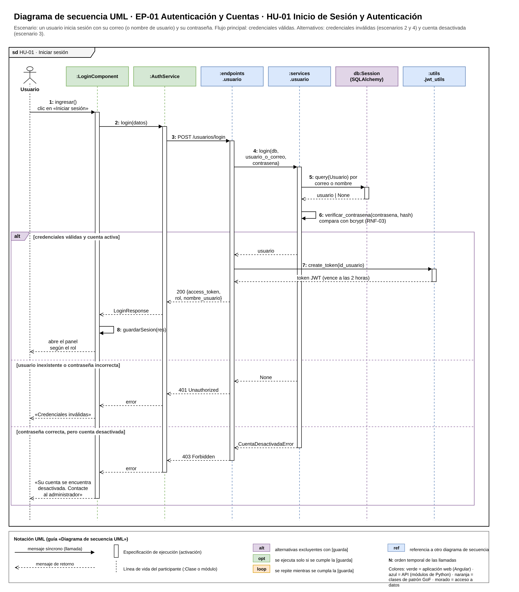

# SD-1 · HU-01 Inicio de Sesión y Autenticación

- Archivo editable: [`SD-1-HU-01-Inicio-de-sesion.drawio`](SD-1-HU-01-Inicio-de-sesion.drawio)
- Enlace editable en draw.io: https://app.diagrams.net/#G1XMrZ2aquA14HxIOd9Vsf_dS2KGhW2kcy

| Elemento | Descripción |
|---|---|
| Escenario | Un usuario inicia sesión con su correo (o su nombre de usuario) y su contraseña. |
| Épica | EP-01 Autenticación y Cuentas |
| Historia de usuario | HU-01 Inicio de Sesión y Autenticación |
| Actor principal | Usuario (Administrador, Instructor o Estudiante) |
| Participantes | `LoginComponent` y `AuthService` (aplicación web); `endpoints.usuario`, `services.usuario` y `utils.jwt_utils` (API); `db:Session` (acceso a datos). |
| Fragmentos combinados | alt con tres operandos |
| Patrón de diseño | No aplica |

## Flujo principal

El usuario da clic en «Iniciar sesión» (1). El componente de la pantalla llama al servicio de autenticación (2), que envía `POST /usuarios/login` (3). La ruta le pide al servicio que verifique las credenciales (4). El servicio busca al usuario por correo o por nombre (5) y compara la contraseña con la que está cifrada con bcrypt (6). Si todo está bien, la ruta crea el token JWT (7) y responde con el token, el rol y el nombre. La aplicación guarda la sesión (8) y abre el panel que le corresponde al rol.

## Flujos alternativos y de excepción

- **Usuario inexistente o contraseña incorrecta (escenarios 2 y 4).** El servicio devuelve `None` y la ruta responde 401 con «Credenciales inválidas». El mensaje es el mismo en los dos casos para no revelar cuál dato falló.
- **Cuenta desactivada (escenario 3).** La contraseña es correcta, pero el servicio lanza `CuentaDesactivadaError`. La ruta responde 403 con «Su cuenta se encuentra desactivada. Contacte al administrador».

## Decisiones técnicas

La contraseña nunca viaja de vuelta ni se guarda en texto plano. La decisión de entrar o no la toma el servicio, no la pantalla. El token lo crea un módulo aparte (`jwt_utils`), que es el mismo que después lo valida en cada petición.
