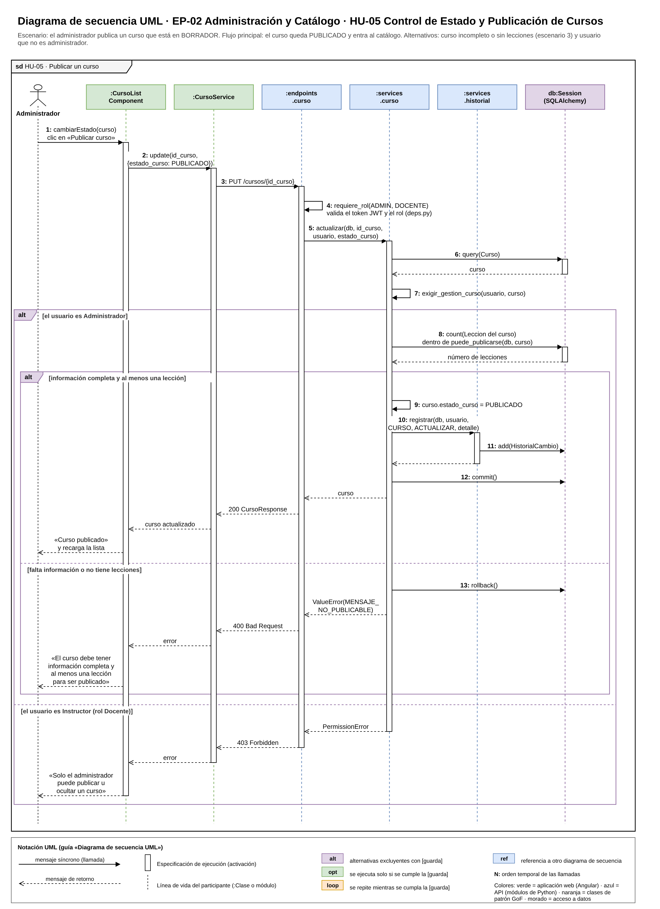

# SD-2 · HU-05 Control de Estado y Publicación de Cursos

- Archivo editable: [`SD-2-HU-05-Publicar-curso.drawio`](SD-2-HU-05-Publicar-curso.drawio)
- Enlace editable en draw.io: https://app.diagrams.net/#G1QsWCq4h5GDxJLAZ327oU9VDKvdAzURim

| Elemento | Descripción |
|---|---|
| Escenario | El administrador publica un curso que está en BORRADOR. |
| Épica | EP-02 Administración y Catálogo |
| Historia de usuario | HU-05 Control de Estado y Publicación de Cursos |
| Actor principal | Administrador |
| Participantes | `CursoListComponent` y `CursoService` (aplicación web); `endpoints.curso`, `services.curso` y `services.historial` (API); `db:Session`. |
| Fragmentos combinados | alt anidado (rol y condiciones de publicación) |
| Patrón de diseño | No aplica |

## Flujo principal

El administrador da clic en «Publicar curso» (1). La aplicación envía `PUT /cursos/{id_curso}` con el estado nuevo (2 y 3). La ruta valida el token y el rol (4) y llama al servicio (5), que busca el curso (6) y comprueba que el usuario lo puede gestionar (7). Como es administrador, el servicio revisa que el curso se pueda publicar: información completa, profesor asignado y al menos una lección (8). Si cumple, cambia el estado a PUBLICADO (9), registra el cambio en el historial (10 y 11, RF-07) y guarda (12). La pantalla muestra «Curso publicado» y el curso aparece en el catálogo.

## Flujos alternativos y de excepción

- **Curso incompleto o sin lecciones (escenario 3).** El servicio deshace los cambios (13) y lanza un error. La ruta responde 400 con «El curso debe tener información completa y al menos una lección para ser publicado». El curso sigue en BORRADOR.
- **El usuario es Instructor.** Solo el administrador cambia el estado de un curso. El servicio lanza `PermissionError` y la ruta responde 403 con «Solo el administrador puede publicar u ocultar un curso». En la pantalla del instructor el botón no aparece; esta validación protege a la API si alguien la llama directamente.

## Decisiones técnicas

La regla de publicación está en el servicio y no en la pantalla, así que se cumple aunque se llame a la API por fuera de la aplicación. El historial se registra dentro de la misma transacción: si el cambio no se guarda, tampoco queda rastro falso.
