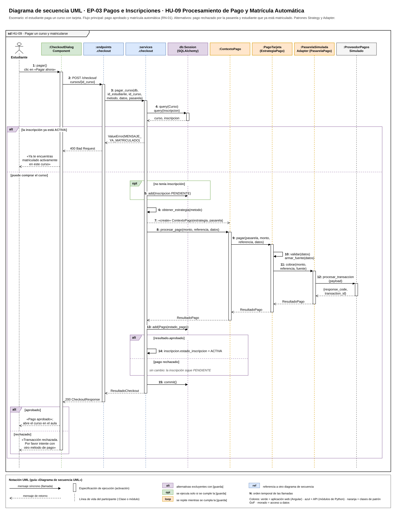

# SD-3 · HU-09 Procesamiento de Pago y Matrícula Automática

- Archivo editable: [`SD-3-HU-09-Pago-y-matricula.drawio`](SD-3-HU-09-Pago-y-matricula.drawio)
- Enlace editable en draw.io: https://app.diagrams.net/#G106I3EXGAJ8Dv1ZPw5NjrG1y8sNUFUJjV

| Elemento | Descripción |
|---|---|
| Escenario | El estudiante paga un curso con tarjeta y queda matriculado. |
| Épica | EP-03 Pagos e Inscripciones |
| Historia de usuario | HU-09 Procesamiento de Pago y Matrícula Automática |
| Actor principal | Estudiante |
| Participantes | `CheckoutDialogComponent` (aplicación web); `endpoints.checkout` y `services.checkout` (API); `db:Session`; `ContextoPago`, `PagoTarjeta`, `PasarelaSimuladaAdapter` y `ProveedorPagosSimulado` (clases de los patrones). |
| Fragmentos combinados | alt (ya matriculado), opt (crear inscripción), alt (resultado del pago) |
| Patrón de diseño | Strategy y Adapter |

## Flujo principal

El estudiante da clic en «Pagar ahora» (1) y la aplicación envía `POST /checkout/cursos/{id_curso}` (2). La ruta llama al servicio de pago y le entrega la pasarela (3). El servicio busca el curso y la inscripción (4). Si el estudiante no tenía inscripción, la crea en estado PENDIENTE (5). Luego elige la estrategia del medio de pago (6), crea el contexto (7) y le pide procesar el pago (8). El contexto delega en la estrategia (9), que valida los datos y arma lo que necesita la pasarela (10) y le pide cobrar al adaptador (11). El adaptador traduce la petición al formato del proveedor (12) y traduce su respuesta a un `ResultadoPago`. El servicio guarda el pago (13), pasa la inscripción a ACTIVA (14) y confirma todo junto (15). La pantalla muestra «Pago aprobado» y abre el curso.

## Flujos alternativos y de excepción

- **Pago rechazado (escenario 2).** El proveedor responde el código 51 y el adaptador lo convierte en un resultado RECHAZADO. El pago rechazado queda guardado, la inscripción sigue PENDIENTE y la pantalla muestra «Transacción rechazada. Por favor intente con otro método de pago». El estudiante puede intentar de nuevo.
- **Ya está matriculado (escenario 3).** Si la inscripción ya está ACTIVA, el servicio no llega a cobrar: lanza un error y la ruta responde 400 con «Ya te encuentras matriculado activamente en este curso».
- **Datos del medio de pago inválidos.** La validación de la estrategia (10) rechaza, por ejemplo, una tarjeta que no tiene 16 dígitos. No se llama a la pasarela ni se guarda nada.

## Decisiones técnicas

Strategy evita un condicional por cada medio de pago: para agregar otro medio se agrega una clase. Adapter aísla al proveedor externo: el servicio solo conoce `PasarelaPago`. La pasarela llega inyectada desde la ruta, y por eso las pruebas usan una pasarela falsa. A la pasarela solo viajan los últimos cuatro dígitos de la tarjeta.
