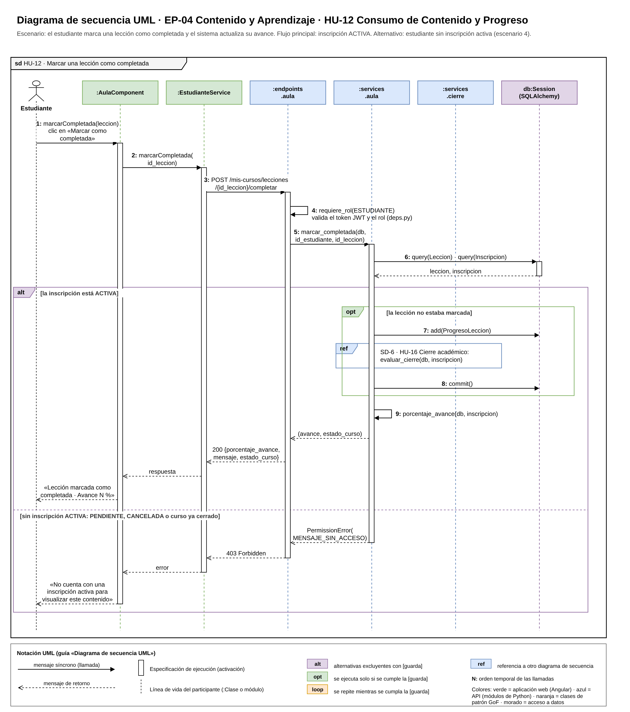

# SD-4 · HU-12 Consumo de Contenido y Progreso

- Archivo editable: [`SD-4-HU-12-Marcar-leccion.drawio`](SD-4-HU-12-Marcar-leccion.drawio)
- Enlace editable en draw.io: https://app.diagrams.net/#G1XYRkLl_I02Rj0pGKYckpnZr1bAg4h7TO

| Elemento | Descripción |
|---|---|
| Escenario | El estudiante marca una lección como completada y el sistema actualiza su avance. |
| Épica | EP-04 Contenido y Aprendizaje |
| Historia de usuario | HU-12 Consumo de Contenido y Progreso |
| Actor principal | Estudiante |
| Participantes | `AulaComponent` y `EstudianteService` (aplicación web); `endpoints.aula`, `services.aula` y `services.cierre` (API); `db:Session`. |
| Fragmentos combinados | alt (inscripción activa o no), opt (lección sin marcar), ref (cierre académico) |
| Patrón de diseño | No aplica (usa el cierre, que aplica Observer) |

## Flujo principal

El estudiante da clic en «Marcar como completada» (1). La aplicación envía `POST /mis-cursos/lecciones/{id_leccion}/completar` (2 y 3). La ruta valida el token y el rol (4) y llama al servicio (5), que busca la lección y la inscripción (6). Con la inscripción ACTIVA, y si la lección no estaba marcada, guarda el avance (7), pide evaluar el cierre del curso (referencia al diagrama SD-6) y confirma (8). Después calcula el porcentaje de avance (9). La pantalla muestra «Lección marcada como completada» y el avance nuevo.

## Flujos alternativos y de excepción

- **Sin inscripción activa (escenario 4).** Si la inscripción está PENDIENTE o CANCELADA, o si el curso ya se cerró, el servicio lanza `PermissionError` y la ruta responde 403 con «No cuenta con una inscripción activa para visualizar este contenido».
- **La lección ya estaba marcada.** El fragmento «opt» no se ejecuta: no se duplica el avance ni se vuelve a evaluar el cierre.

## Decisiones técnicas

El avance y el posible cierre del curso se guardan en la misma transacción. El aula no decide si el curso se cierra: solo se lo pregunta al componente de cierre por la interfaz `IEvaluarCierre`.
