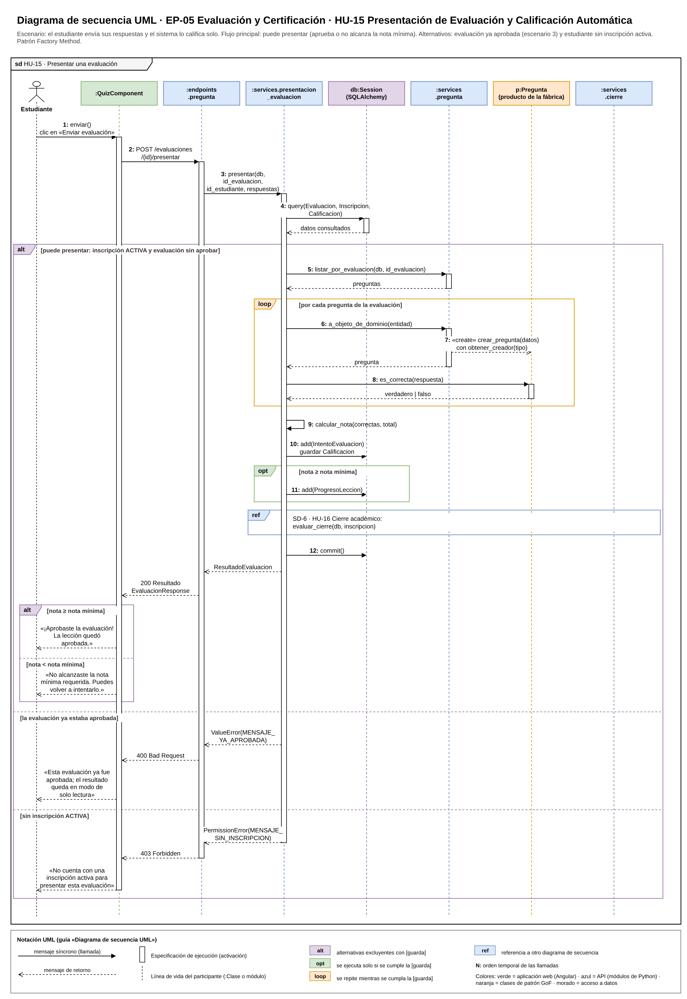

# SD-5 · HU-15 Presentación de Evaluación y Calificación Automática

- Archivo editable: [`SD-5-HU-15-Presentar-evaluacion.drawio`](SD-5-HU-15-Presentar-evaluacion.drawio)
- Enlace editable en draw.io: https://app.diagrams.net/#G10no_oxfSf09EL-8V8dbP_1yPEMg0VmNG

| Elemento | Descripción |
|---|---|
| Escenario | El estudiante envía sus respuestas y el sistema lo califica automáticamente. |
| Épica | EP-05 Evaluación y Certificación |
| Historia de usuario | HU-15 Presentación de Evaluación y Calificación Automática |
| Actor principal | Estudiante |
| Participantes | `QuizComponent` (aplicación web); `endpoints.pregunta`, `services.presentacion_evaluacion`, `services.pregunta` y `services.cierre` (API); `db:Session`; `p:Pregunta` (producto de la fábrica). |
| Fragmentos combinados | alt con tres operandos, loop (por cada pregunta), opt (aprobó), alt (mensaje), ref (cierre) |
| Patrón de diseño | Factory Method |

## Flujo principal

El estudiante da clic en «Enviar evaluación» (1) y la aplicación envía `POST /evaluaciones/{id}/presentar` (2). El servicio busca la evaluación, la inscripción y la nota anterior (4). Si puede presentar, trae las preguntas (5) y, por cada una, pide a la fábrica el objeto del tipo correcto (6 y 7) y le pregunta si la respuesta es correcta (8). Con el número de aciertos calcula la nota (9), guarda el intento y la nota vigente (10) y, si aprobó, marca la lección como completada (11). Luego pide evaluar el cierre del curso (referencia a SD-6) y confirma todo junto (12). La pantalla muestra «¡Aprobaste la evaluación! La lección quedó aprobada.»

## Flujos alternativos y de excepción

- **No alcanza la nota mínima (escenario 2).** El intento queda guardado y la pantalla muestra «No alcanzaste la nota mínima requerida. Puedes volver a intentarlo.» La inscripción sigue ACTIVA.
- **La evaluación ya estaba aprobada (escenario 3).** El servicio no califica de nuevo: la ruta responde 400 con «Esta evaluación ya fue aprobada; el resultado queda en modo de solo lectura».
- **Sin inscripción activa.** La ruta responde 403 con «No cuenta con una inscripción activa para presentar esta evaluación».

## Decisiones técnicas

El servicio que califica no sabe si la pregunta es de opción múltiple o de verdadero o falso: solo usa `es_correcta()`. Agregar un tipo de pregunta no cambia la calificación. Intento, nota y cierre se guardan juntos o no se guarda ninguno.
