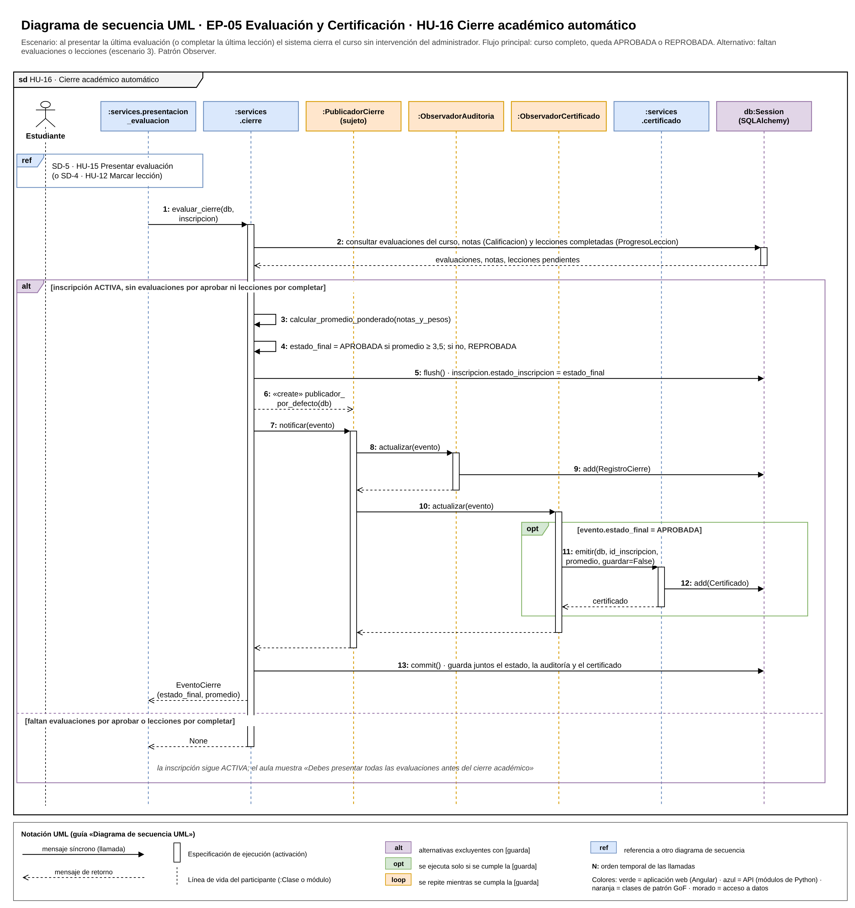

# SD-6 · HU-16 Cierre académico automático

- Archivo editable: [`SD-6-HU-16-Cierre-academico.drawio`](SD-6-HU-16-Cierre-academico.drawio)
- Enlace editable en draw.io: https://app.diagrams.net/#G1w6xWu0EwMo6yAPaQ7rZbC7pTZNYMWPqT

| Elemento | Descripción |
|---|---|
| Escenario | Al presentar la última evaluación o completar la última lección, el sistema cierra el curso sin intervención del administrador. |
| Épica | EP-05 Evaluación y Certificación |
| Historia de usuario | HU-16 Cierre académico automático |
| Actor principal | Estudiante (lo dispara al presentar una evaluación o completar una lección) |
| Participantes | `services.presentacion_evaluacion` (o `services.aula`), `services.cierre` y `services.certificado` (API); `PublicadorCierre`, `ObservadorAuditoria` y `ObservadorCertificado` (clases del patrón); `db:Session`. |
| Fragmentos combinados | ref (origen), alt (curso completo o no), opt (solo si aprobó) |
| Patrón de diseño | Observer |

## Flujo principal

El servicio que atendió al estudiante llama a `evaluar_cierre()` (1). El cierre consulta las evaluaciones, las notas y las lecciones completadas (2). Si no falta nada, calcula el promedio ponderado (3), decide el estado final (4) y lo deja listo en la inscripción (5). Luego arma el publicador con sus dos observadores (6) y le pide notificar el cierre (7). El observador de auditoría guarda el registro de cierre (8 y 9). El observador de certificados, solo si el estado final es APROBADA, pide emitir el certificado (10 a 12). Al final se confirma todo junto: estado, auditoría y certificado (13).

## Flujos alternativos y de excepción

- **Faltan evaluaciones o lecciones (escenario 3).** El cierre devuelve `None` y no cambia nada. La inscripción sigue ACTIVA y el aula muestra «Debes presentar todas las evaluaciones antes del cierre académico».
- **Promedio menor que 3,5 (escenario 2).** Es el mismo flujo, pero el estado final es REPROBADA: el fragmento «opt» no se ejecuta y no se emite certificado. El registro de cierre sí se guarda.

## Decisiones técnicas

El cierre solo avisa; cada observador sabe qué hacer. Para agregar otra reacción al cierre, por ejemplo enviar un correo, se suscribe otro observador y el servicio de cierre no cambia. El observador de certificados recibe la función de emisión inyectada (DIP).
