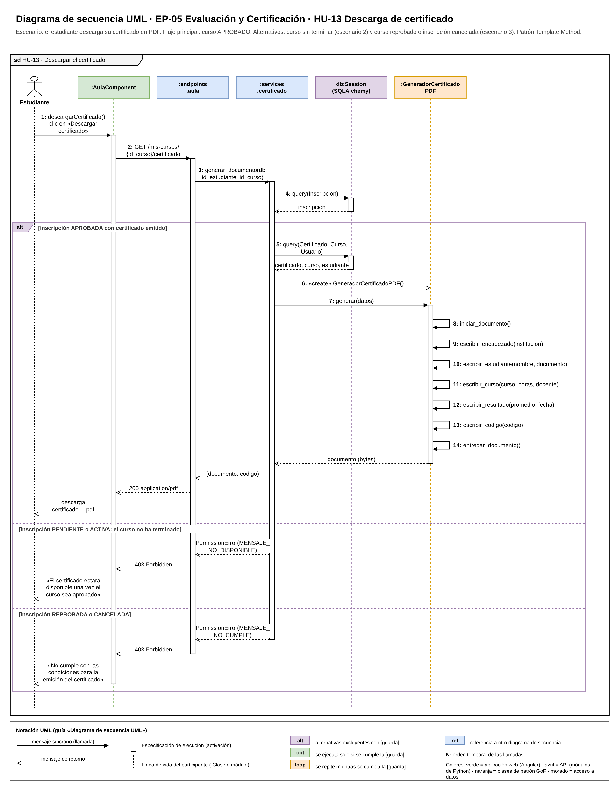

# SD-7 · HU-13 Descarga de certificado

- Archivo editable: [`SD-7-HU-13-Descargar-certificado.drawio`](SD-7-HU-13-Descargar-certificado.drawio)
- Enlace editable en draw.io: https://app.diagrams.net/#G1aqiY1wQKNq8RFCW3SJoOgmmopeGa8BNo

| Elemento | Descripción |
|---|---|
| Escenario | El estudiante descarga su certificado en PDF. |
| Épica | EP-05 Evaluación y Certificación |
| Historia de usuario | HU-13 Descarga de certificado |
| Actor principal | Estudiante |
| Participantes | `AulaComponent` (aplicación web); `endpoints.aula` y `services.certificado` (API); `db:Session`; `GeneradorCertificadoPDF` (clase concreta de `GeneradorCertificado`). |
| Fragmentos combinados | alt con tres operandos |
| Patrón de diseño | Template Method |

## Flujo principal

El estudiante da clic en «Descargar certificado» (1) y la aplicación envía `GET /mis-cursos/{id_curso}/certificado` (2). El servicio busca la inscripción (4). Si está APROBADA y tiene certificado, reúne los datos (5), crea el generador de PDF (6) y le pide generar el certificado (7). El método plantilla `generar()` de la clase base llama los pasos en orden: iniciar el documento, encabezado, estudiante, curso, resultado y código de verificación (8 a 13), y entrega el documento terminado (14). La ruta responde con el PDF y el navegador lo descarga.

## Flujos alternativos y de excepción

- **Curso sin terminar (escenario 2).** Con la inscripción PENDIENTE o ACTIVA la ruta responde 403 con «El certificado estará disponible una vez el curso sea aprobado». En la pantalla el botón aparece inhabilitado con ese mismo mensaje.
- **Curso reprobado o inscripción cancelada (escenario 3).** La ruta responde 403 con «No cumple con las condiciones para la emisión del certificado».

## Decisiones técnicas

La clase base `GeneradorCertificado` fija el orden de los pasos en `generar()` y cada clase concreta escribe cada paso en su formato. Hoy hay generador de PDF y de texto; para otro formato se agrega otra clase concreta y el orden no se toca. El certificado no se puede emitir a mano: lo emitió el cierre (SD-6).
